# Vantage

Portfolio manager: one place to keep and look through your holdings, trades, events and news.

[Use it live](https://vantage.personal-553.workers.dev) or [deploy your own](docs/deploy.md).

## Features

### Watchlist

The companies you follow, in your own groups, priced live.

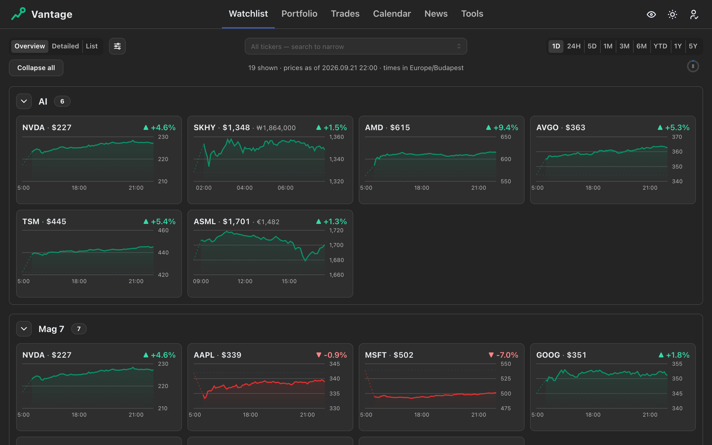

#### Realistic time gaps

See when each market traded and how the sessions overlap.

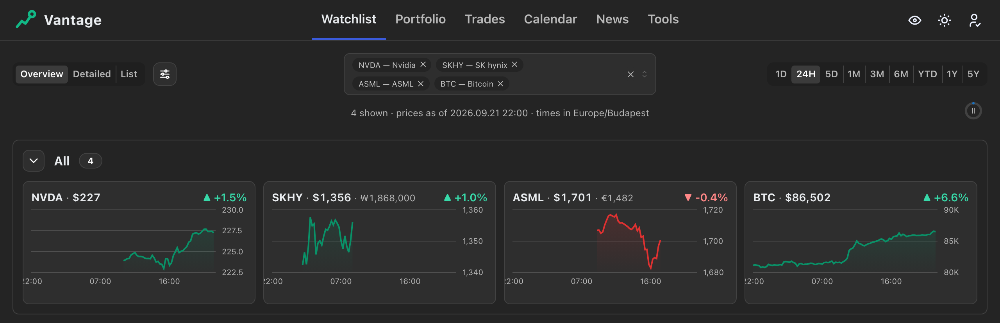

#### Short time gaps

Compare the moves themselves, without the hours a market was shut.

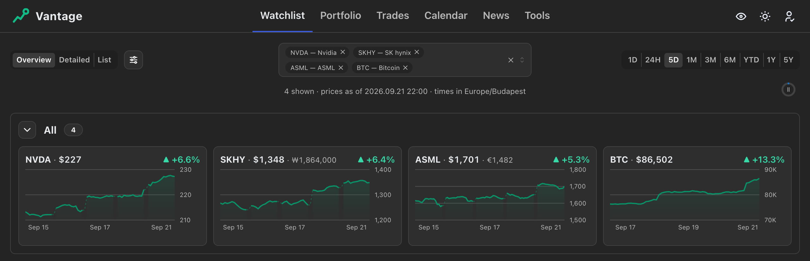

#### List

Every horizon at a glance.

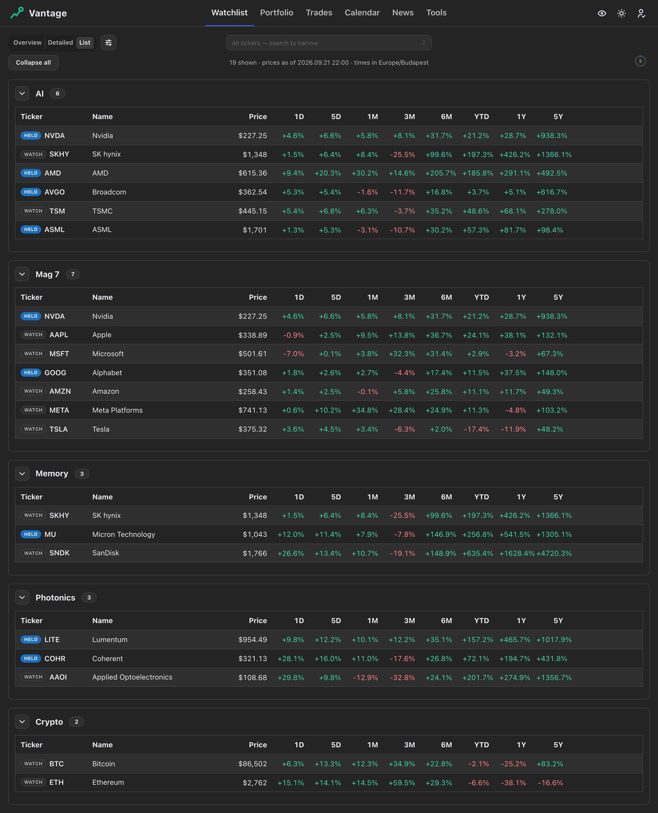

#### On a phone

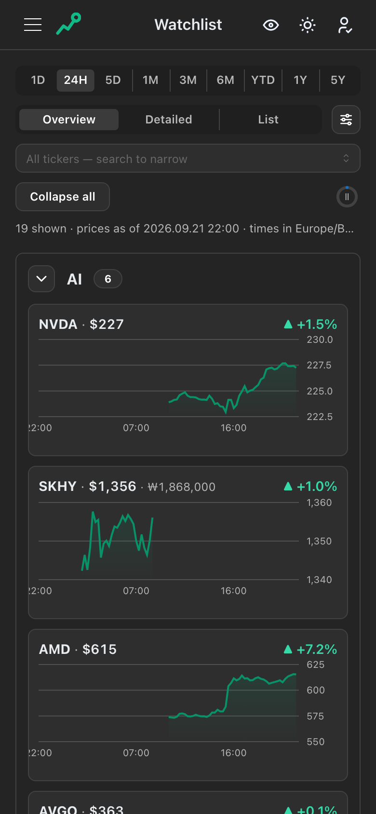

### Portfolio

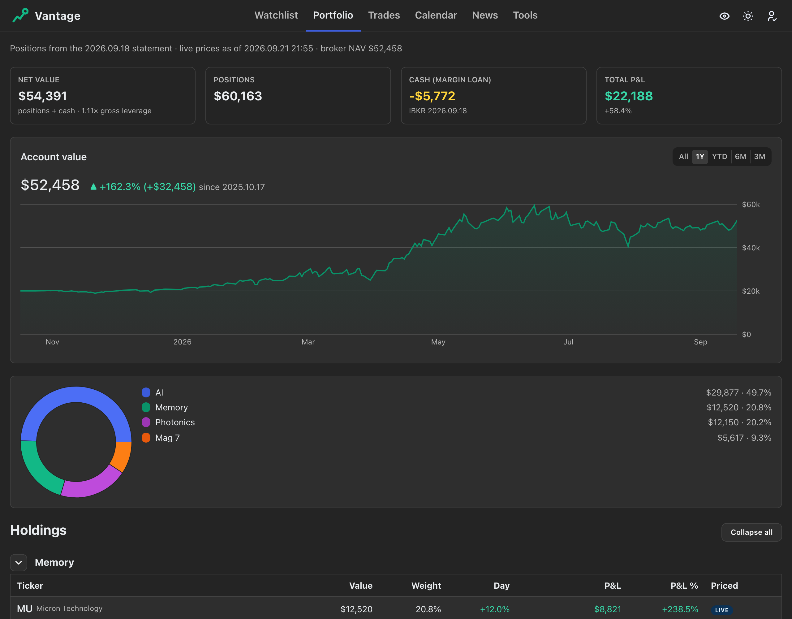

#### Hidden values

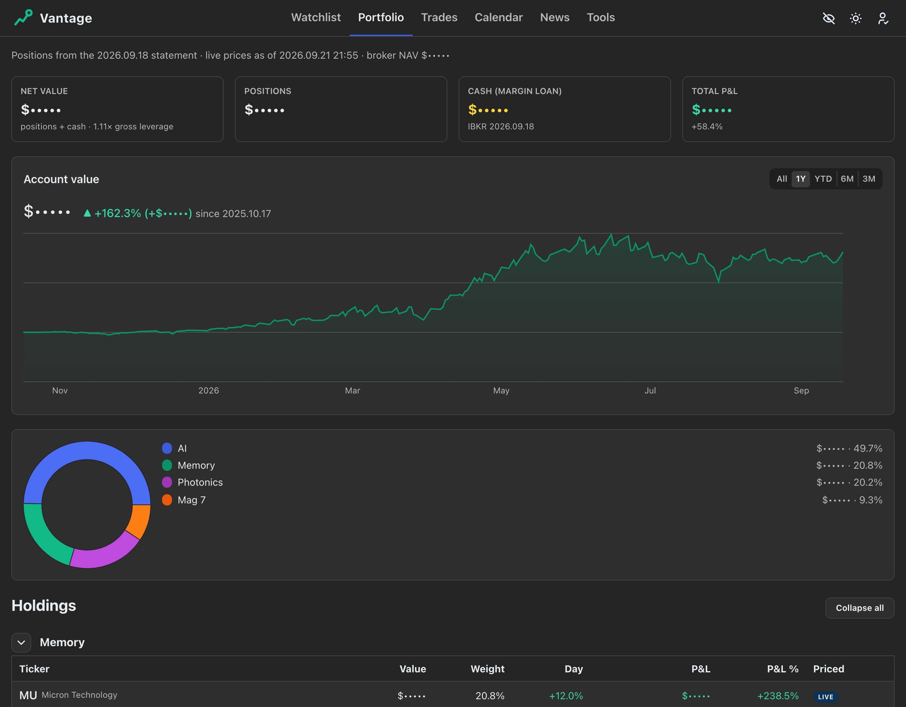

### Trades

#### Names

How each bet on a company is going, closed and still held.

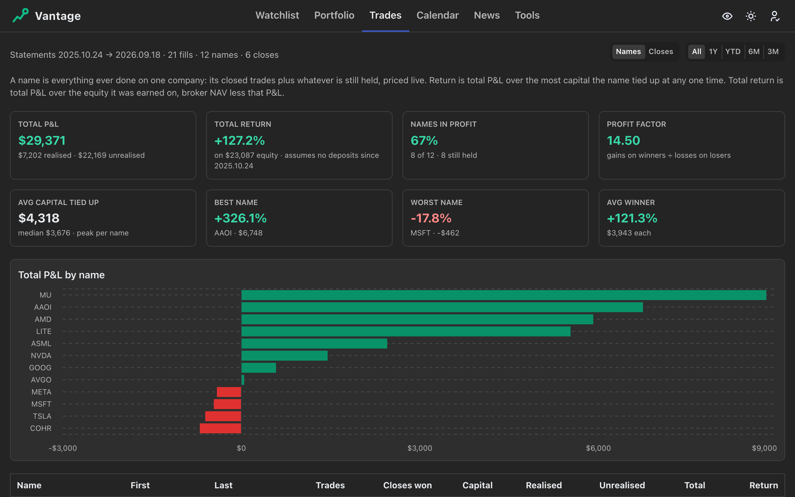

#### Closes

How good your exits are.

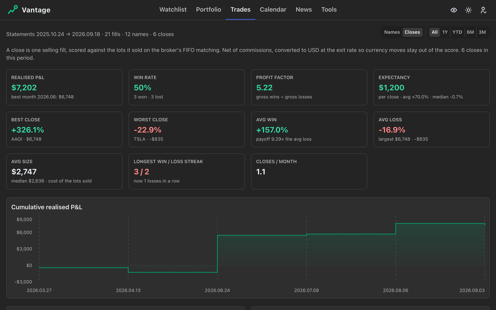

### Calendar

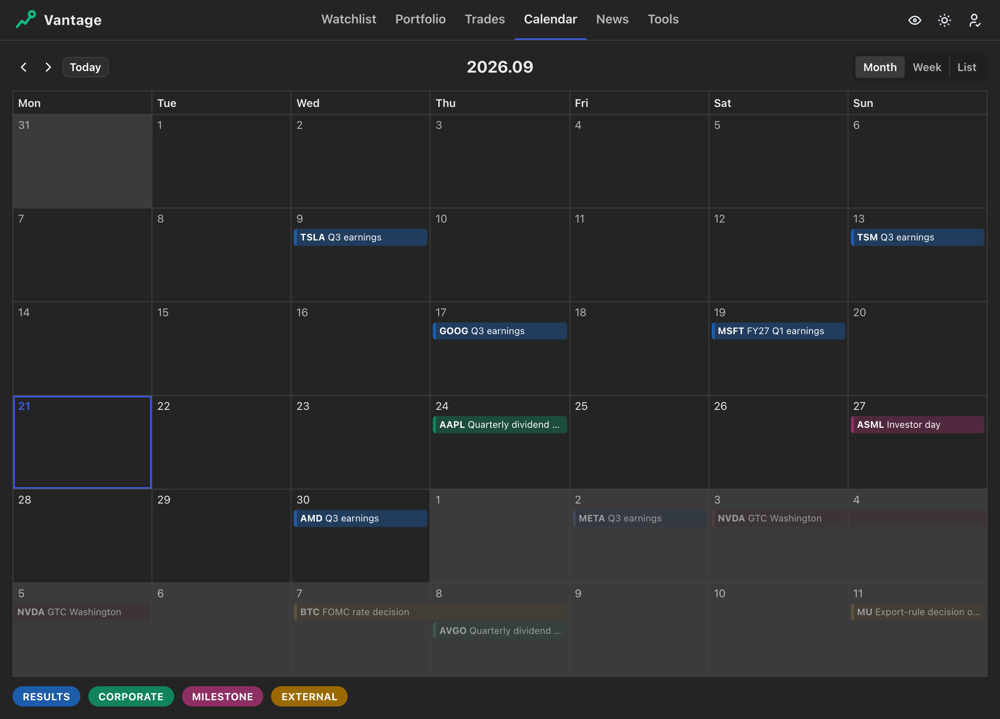

### News

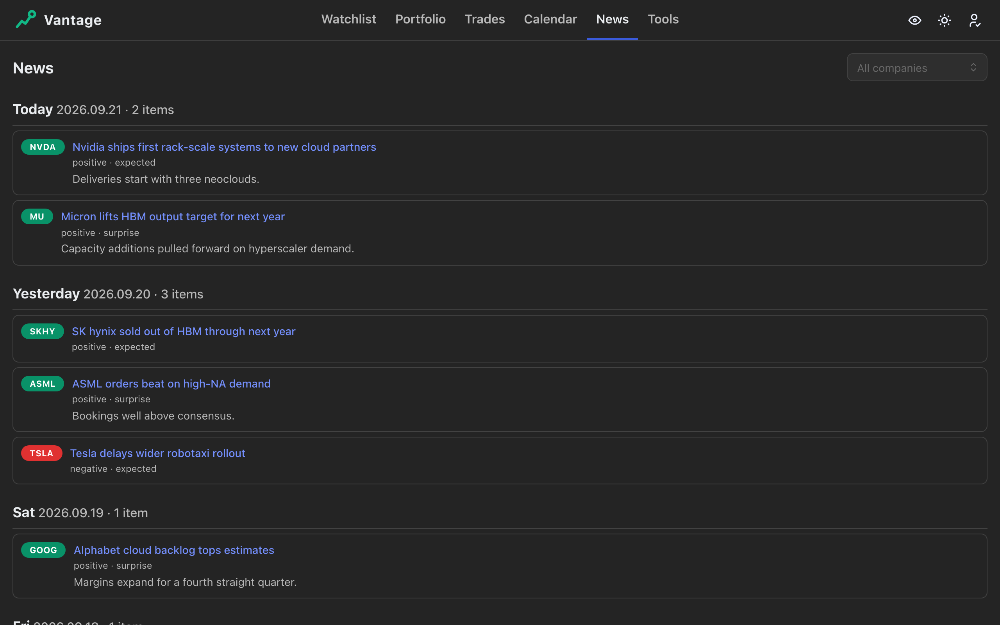

### Tools

#### Margin sizing

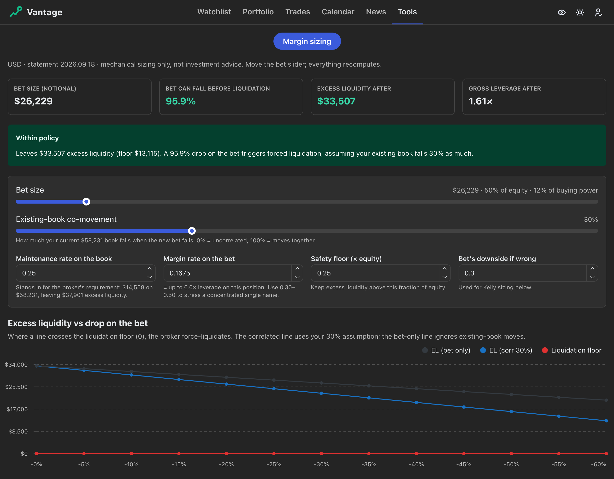

### Agent API

An agent can create your account, then read and write all of the above through the REST API, including your broker statements and fills. You can make and revoke agent keys.
